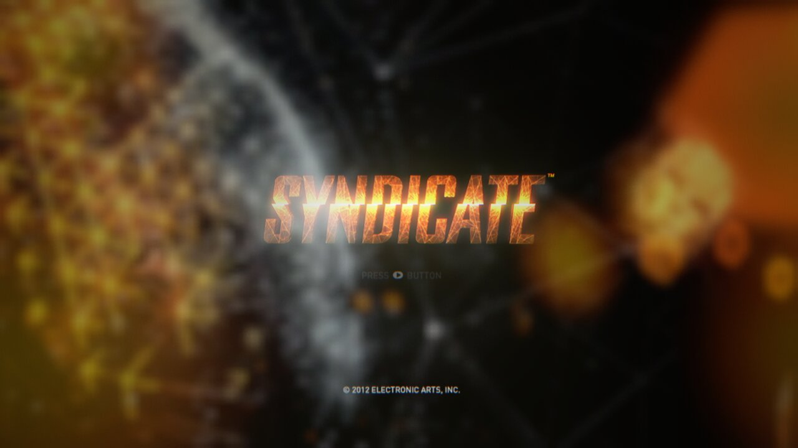

<div align=center>

</div>

---

Static recompilation of the Xbox 360 version of Syndicate (2012) using rexglue-sdk.

The project is fully vibecoded.

This repo is released as a rexglue-sdk recipe for recompiling and playing your **legally owned and purchased** Xbox 360 copy of Syndicate on PC, using emulated Xbox 360 rendering.

Work in progress: the game compiles, boots and reaches the title screen ("Press Start"). Menus and gameplay have not been tested yet.

**Rendering:** `config/syndicate.toml` uses the accurate EDRAM path, `render_target_path_vulkan = "fsi"`. The title screen was checked with the faster `"fbo"` path. On some NVIDIA GPUs `fsi` can trip the driver watchdog (`Xid 109` in `journalctl -k`); if the game hangs, switch to `"fbo"`.

Contributions that make the PC version run better, such as a native renderer, are welcome and appreciated.

### Instructions

Requirements: Linux, clang-20, CMake 3.25+, Ninja, a Vulkan GPU (with fragment shader interlock support for the `fsi` path).

1. Clone the repo with its submodules. rexglue-sdk is pinned to upstream commit `bd833a2`
   in `thirdparty/rexglue-sdk`. Then apply the SDK patches:

   ```bash
   git clone --recursive <this repo's URL> syndicate-recomp
   cd syndicate-recomp
   tools/apply_patches.sh
   ```

2. Extract your copy of the game (`default.xex` and its data files) into
   `syndicate-extract/` (it is gitignored). Only the `default.xex` with SHA-256
   `0da0f0e48f54d2d693c0b368310ffd0b94b6038b5b0c5a55fdabb9d667625450`
   (Title ID 45410923) is supported.

   ```text
   syndicate-recomp/
     syndicate-extract/
       default.xex
       Content/
       ...
     thirdparty/rexglue-sdk/
   ```

3. Build. The SDK is built as part of the project. The first build runs codegen
   (a few minutes) and then compiles the recompiled game, which takes a while.

   ```bash
   cmake --preset linux-amd64-release
   cmake --build --preset linux-amd64-release
   ```

4. Run:

   ```bash
   tools/run.sh
   ```

   The script removes guest memory segments left in `/dev/shm` by crashed runs and selects
   the NVIDIA GPU on hybrid laptops. Runtime settings are in `config/syndicate.toml`.
   The runtime log is written to `out/build/linux-amd64-release/logs/`, not to the terminal.

   If the game hangs or crashes, `tools/debug_hang.sh` runs it under gdb: press Ctrl+C at the
   stuck point (a crash stops by itself) and all thread stacks are written to `out/hang_stacks.txt`.

### Changes

rexglue-sdk patches (`patches/`, on top of upstream `bd833a2`), taken unchanged from
[the-darkness-2-recomp](https://github.com/panalexeu/the-darkness-2-recomp) (originally from
[singularity-recomp](https://github.com/panalexeu/singularity-recomp)):

- `0001` Vulkan: discard stencil bit transfer pixels by the source stencil
- `0002` Vulkan: read texture exp_adjust from fetch constant word 3 (upstream PR #490)
- `0003` Remap shader oDepth to host [0, 0.5] for float24 depth in FBO mode
- `0004` Create the achievement toast only while it has something to show

Config (`config/syndicate.toml`):

| Setting | Effect |
|---|---|
| `gpu_plugin = "xenos"` | Loads the Xbox 360 GPU emulation. Without it every `Vd*` call is ignored and the game hangs on a black window waiting for the GPU |
| `render_target_path_vulkan = "fsi"` | Accurate EDRAM emulation; `"fbo"` is faster |
| `fullscreen = false`, 1280x720 | Windowed mode |
| `vulkan_allow_present_mode_immediate/mailbox = false` | Presents with vsync instead of redrawing the same frame hundreds of times per second |
| `readback_memexport = false`, `clear_memory_page_state = false` | Xenia Canary's defaults; avoids CPU stalls after GPU particle effects |

`overrides.toml` declares 402 function entry points the codegen analyzer misses. Without them
the game stops with "call to invalid or unregistered function" when one is called (the first
run stopped at `0x82FC4518`, a function reached only through a data-section pointer).

| Count | How it was found |
|---:|---|
| 401 | Code addresses in the game's data sections, or built in code with `lis`+`addi`, pointing into gaps between detected functions, found by scanning the loaded image with `tools/find_missing_functions.py` ("strong" candidates). Two strong candidates (`0x82BBB7B8`, `0x82BF786C`) were left out: they pointed inside real functions and made codegen fail with unresolved branches |
| 1 | `0x825B1538`, a leaf function with no references, found from codegen's "Unresolved conditional branch to 0x825B157C" |

The scan also lists 684 weaker "review" candidates. They are not needed to reach the title
screen; if a later run stops with "call to invalid or unregistered function", look up the
address there and add it.

To redo the scan, dump the loaded image and run the script:

```bash
DUMP_IMAGE=$PWD/out/image_82000000.bin tools/run.sh   # close the game after the "[dump] wrote" line
python3 tools/find_missing_functions.py out/image_82000000.bin
```

`tools/disasm.sh out/image_82000000.bin <address> [count]` disassembles guest code from the dump.
The dump is game data: keep it local, never commit or share it.
